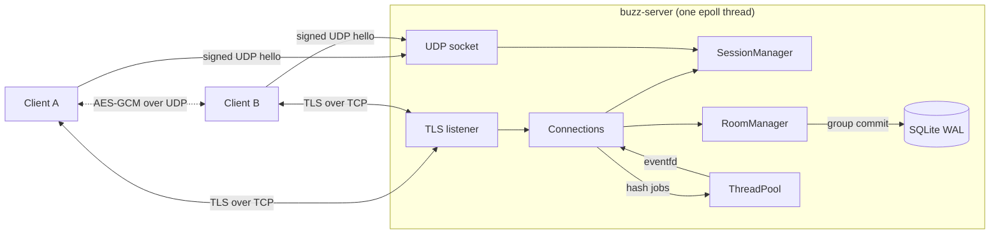

# Buzz

Buzz is a hybrid messenger written in C++17. The server handles accounts, sessions and chatrooms over TLS. Direct messages go peer-to-peer over encrypted UDP, and the server only introduces the two peers.

[](https://github.com/kwyj1bo/buzz/actions/workflows/ci.yml)

## Features

- **Accounts and login.** Passwords are stored as salted PBKDF2-HMAC-SHA256 hashes (600,000 iterations). Hashing runs on a worker thread pool, so it never blocks the event loop.
- **Session management.** Login returns a session token. If the connection drops, the client reconnects with backoff and resumes the session with the token. A second login of the same user takes over the session and closes the old connection. Sessions are stored in SQLite (only a SHA-256 of each token), so a server restart does not log users out.
- **Chatrooms with data sync.** Each room numbers its messages. On reconnect the client rejoins each room with the last sequence number it saw, and the server replays only the missed messages.
- **SQLite persistence.** Accounts, sessions and room history are stored in SQLite (WAL mode) and survive restarts. Rooms load lazily on first use. The server keeps the newest 256 messages per room in memory and reads older gaps from disk. Messages posted during one event loop pass are written in a single transaction (group commit). If the disk fails, writes retry with backoff and the queue stays bounded.
- **Paged history replay.** A rejoin can replay up to 1,000 missed messages. The server sends them as the socket drains, so a large backlog never overflows the output buffer.
- **End-to-end encrypted peer-to-peer messages.** Peers agree on an AES-256-GCM key with X25519 and HKDF. The server forwards only public keys, so it cannot read direct messages. `/verify <user>` shows a safety number; if both users see the same one, nobody (including the server) swapped the keys. Messages go directly between the peers over UDP, with acknowledgements, retransmission and duplicate filtering, and keep working when the server is down.
- **Address privacy.** A peer's IP address is shared only when that peer's client accepts the request. Clients accept only contacts (users they share a room with or have messaged); requests from strangers are declined and fall back to the relay.
- **Relay fallback.** If a direct UDP path does not work (for example behind a symmetric NAT), the client retries for about 1.75 s and then sends the message through the server over TLS. A peer that stops answering is dropped, so the next message asks for a fresh introduction.
- **Hardening.**
  - A per-connection token bucket covers every request type.
  - Register and Login draw from a per-IP budget (each costs a PBKDF2 hash).
  - A username is locked after repeated failed logins; the lock doubles up to an hour and survives reconnects.
  - Rooms with no members are freed or evicted, and each user can be in at most 64 rooms, so the room limit cannot be exhausted.
  - TLS handshake and login timeouts, a 64 KiB frame limit and a cap on per-connection output buffers.
  - Room text with control characters is rejected, so clients cannot inject terminal escape sequences.
- **Scalable server.** One thread runs a level-triggered `epoll` loop over non-blocking TLS sockets, a UDP socket, an `eventfd` and a `timerfd`. Room broadcasts encode a frame once and share it with all members.
- **TLS everywhere on TCP.** OpenSSL 3, TLS 1.2 or later. The client verifies the server certificate and host name.
- **Tests.** GoogleTest unit and end-to-end suites run under AddressSanitizer and UndefinedBehaviorSanitizer in GitHub Actions, with GCC and Clang. The pipeline then builds and smoke-tests the Docker image.

## Architecture



1. A client logs in over TLS and gets a session token.
2. The client sends a UDP hello to the server. The hello is signed with an HMAC keyed by a hash of the token, over a per-connection nonce and an increasing counter, so it cannot be forged or replayed. The server records the public address it sees, which works through most NATs.
3. `/dm bob hi` sends Alice's X25519 public key to the server, which offers it to Bob. If Bob's client accepts, it answers with its own public key, and the server tells Alice Bob's endpoint. Each side derives the same AES-256-GCM key with HKDF; the server never sees it.
4. The peers exchange encrypted, acknowledged datagrams directly. If Bob declines or no acknowledgement arrives, the client relays the message through the server.

### Wire protocol

Every message is `u8 type | u16 field_count | (u32 length | bytes) * field_count`. Integers are big-endian. On TCP each message has a `u32` length prefix (max 64 KiB). On UDP each datagram holds one message. Peer datagrams are `u8 sender_length | sender | AES-256-GCM(message)`, with the sender name as associated data.

| Client to server | Server to client | UDP |
| --- | --- | --- |
| `Register`, `Login`, `Resume`, `Logout` | `Ok`, `Error`, `Welcome` | `UdpHello`, `UdpAck` |
| `Join(room, since?)`, `Leave`, `Say` | `RoomMsg`, `RoomEvent`, `SyncDone` | `DmData`, `DmAck`, `DmPunch` |
| `ListRooms`, `Who`, `Ping` | `Rooms`, `Members`, `Pong` | |
| `PeerRequest(to, pubkey)`, `PeerAccept(from, pubkey)`, `PeerDecline(from)` | `PeerOffer(from, endpoint, pubkey)`, `PeerInfo(to, endpoint, pubkey)` | |
| `Relay(to, text)` | `Relayed(from, text)` | |

## Performance

Measured with `buzz-bench` on a GitHub Actions runner: 2 vCPU (1 physical core with 2 threads), 7 GiB RAM. The server and the load generator share that machine and talk over loopback with TLS 1.3, so these are lower bounds. The full report is in [docs/benchmarks.md](docs/benchmarks.md).

| Scenario | Result |
| --- | --- |
| Concurrent logged-in TLS connections | 10,000 at about 24.5 KiB each (303 MiB RSS) |
| Ping round trip with 10,000 connections open | p50 71 µs, p99 88 µs |
| Chat fan-out, 1,000 clients in 50 rooms of 20 | 40,000 deliveries/s at p50 0.76 ms, p99 5.3 ms, 57% of one core |
| Chat fan-out at half that load | 20,000 deliveries/s at p50 0.44 ms, p99 3.1 ms |
| Peak chat throughput (closed loop) | about 47,000 deliveries/s |
| TLS handshakes | about 1,100 per second |
| Replay of 1,000 missed messages from SQLite | 12 ms |
| Event loop during a login storm (PBKDF2 600k on the worker pool) | ping p50 59 µs while both CPU threads hash |
| Peer-to-peer AES-GCM UDP round trip | p50 63 µs |

Run the benchmarks yourself on Linux:

```bash
cmake -S . -B build -G Ninja -DCMAKE_BUILD_TYPE=Release -DBUZZ_BUILD_TESTS=OFF
cmake --build build
scripts/bench.sh build/src bench-results.md
```

The `Benchmark` workflow runs the same script on every push to `main` and publishes the report in the job summary.

## Build

Buzz builds on Linux (it uses `epoll`). You need CMake 3.16+, a C++17 compiler, OpenSSL 3 and SQLite 3. On other systems, use Docker.

```bash
sudo apt-get install -y build-essential cmake ninja-build libssl-dev libsqlite3-dev
cmake -S . -B build -G Ninja -DCMAKE_BUILD_TYPE=Release
cmake --build build
ctest --test-dir build --output-on-failure
```

Sanitizer build: add `-DBUZZ_SANITIZE=ON -DCMAKE_BUILD_TYPE=Debug`.

## Run

Start the server. `--gen-cert` creates a self-signed certificate if none exists:

```bash
./build/src/buzz-server --port 7000 --gen-cert
```

Start a client in each of two terminals:

```bash
./build/src/buzz --host 127.0.0.1 --port 7000 --ca certs/server.crt
```

```text
/register alice password123
/login alice password123
/join general
hello everyone
/dm bob are you there?
```

Type `/help` for all commands.

### Docker

```bash
docker compose up -d server
docker compose run --rm client
```

Run the second command in two terminals to chat. The image is also published to `ghcr.io/kwyj1bo/buzz-server` on every push to `main`.

## Server options

| Option | Default | Description |
| --- | --- | --- |
| `--port` | 7000 | TLS port |
| `--udp-port` | same as `--port` | UDP port for peer discovery |
| `--db` | `buzz.db` | SQLite file; `""` keeps everything in memory |
| `--cert`, `--key` | `certs/server.crt`, `certs/server.key` | PEM files |
| `--gen-cert` | off | create a self-signed certificate if missing |
| `--cert-host` | none | extra DNS name or IP in the generated certificate |
| `--threads` | 4 | password hashing workers |
| `--pbkdf2-iterations` | 600000 | password hashing cost |
| `--message-rate` | 30 | requests per second per connection |
| `--message-burst` | 60 | burst allowance for `--message-rate` |
| `--auth-rate` | 20 | logins and registrations per minute per IP |
| `--auth-burst` | 10 | burst allowance for `--auth-rate` |
| `--session-ttl` | 300 | seconds a dropped session can be resumed |
| `--log-level` | info | `debug`, `info`, `warn` or `error` |

## Project layout

```text
include/buzz/   public headers of the core library
src/core/       protocol, crypto, TLS, sessions, rooms, storage, reliable UDP
src/server/     epoll event loop and protocol handlers
src/client/     interactive client, server link and peer manager
src/bench/      buzz-bench load generator
tests/          GoogleTest unit and end-to-end suites
scripts/        end-to-end and benchmark scripts
```

## Limits

- Relayed direct messages are protected by TLS on each leg, but the server can read them. Only the peer-to-peer path is end-to-end encrypted.
- Keys are per client run, not long-term identities. A malicious server could swap public keys during an introduction; comparing safety numbers with `/verify` detects this.
- The UDP hello and its ack are not encrypted. The hello is authenticated, so it cannot be forged or replayed.
