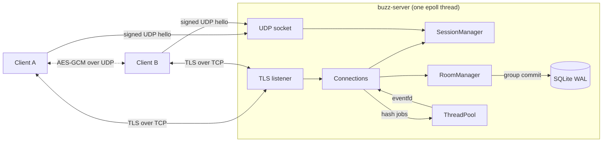

# Buzz

Buzz is a hybrid messenger written in C++17. The server handles accounts, sessions and chatrooms over TLS. Direct messages go peer-to-peer over encrypted UDP, and the server only introduces the two peers.

[](https://github.com/kwyj1bo/buzz/actions/workflows/ci.yml)

## Features

- **Accounts and login.** Passwords are stored as salted PBKDF2-HMAC-SHA256 hashes (600,000 iterations). Hashing runs on a worker thread pool, so it never blocks the event loop.
- **Session management.** Login returns a session token. If the connection drops, the client reconnects with backoff and resumes the session with the token. A second login of the same user takes over the session and closes the old connection.
- **Chatrooms with data sync.** Each room numbers its messages. On reconnect the client rejoins each room with the last sequence number it saw, and the server replays only the missed messages.
- **SQLite persistence.** Accounts and room history are stored in SQLite (WAL mode) and survive restarts. The server keeps the newest 256 messages per room in memory and reads older gaps from disk. Messages posted during one event loop pass are written in a single transaction (group commit).
- **Peer-to-peer direct messages.** The server sends each peer the other's UDP endpoint and a fresh AES-256-GCM key. Messages then go directly between the peers, with acknowledgements, retransmission and duplicate filtering. Direct messages continue to work when the server is down.
- **Relay fallback.** If a direct UDP path does not work (for example behind a symmetric NAT), the client retries for about 1.75 s and then sends the message through the server over TLS.
- **Hardening.** Per-connection token-bucket rate limits, a TLS handshake timeout, a login timeout, a limit on failed logins per connection, a 64 KiB frame limit and a cap on per-connection output buffers. Room text with control characters is rejected, so clients cannot inject terminal escape sequences.
- **Scalable server.** One thread runs a level-triggered `epoll` loop over non-blocking TLS sockets, a UDP socket, an `eventfd` and a `timerfd`. Room broadcasts encode a frame once and share it with all members.
- **TLS everywhere on TCP.** OpenSSL 3, TLS 1.2 or later. The client verifies the server certificate and host name.
- **Tests.** GoogleTest unit and end-to-end suites run under AddressSanitizer and UndefinedBehaviorSanitizer in GitHub Actions, with GCC and Clang. The pipeline then builds and smoke-tests the Docker image.

## Architecture



1. A client logs in over TLS and gets a session token.
2. The client sends a UDP hello to the server, signed with an HMAC of its token. The server records the public address it sees, which works through most NATs.
3. `/dm bob hi` asks the server to introduce the two peers. Both receive the other's endpoint and a shared key over TLS.
4. The peers exchange encrypted, acknowledged datagrams directly. If no acknowledgement arrives, the client relays the message through the server.

### Wire protocol

Every message is `u8 type | u16 field_count | (u32 length | bytes) * field_count`. Integers are big-endian. On TCP each message has a `u32` length prefix (max 64 KiB). On UDP each datagram holds one message. Peer datagrams are `u8 sender_length | sender | AES-256-GCM(message)`, with the sender name as associated data.

| Client to server | Server to client | UDP |
| --- | --- | --- |
| `Register`, `Login`, `Resume`, `Logout` | `Ok`, `Error`, `Welcome` | `UdpHello`, `UdpAck` |
| `Join(room, since?)`, `Leave`, `Say` | `RoomMsg`, `RoomEvent`, `SyncDone` | `DmData`, `DmAck`, `DmPunch` |
| `ListRooms`, `Who`, `PeerRequest`, `Ping` | `Rooms`, `Members`, `PeerInfo`, `Pong` | |
| `Relay(to, text)` | `Relayed(from, text)` | |

## Build

Buzz builds on Linux (it uses `epoll`). You need CMake 3.16+, a C++17 compiler, OpenSSL 3 and SQLite 3. On other systems, use Docker.

```bash
sudo apt-get install -y build-essential cmake ninja-build libssl-dev libsqlite3-dev
cmake -S . -B build -G Ninja -DCMAKE_BUILD_TYPE=Release
cmake --build build
ctest --test-dir build --output-on-failure
```

Sanitizer build: add `-DBUZZ_SANITIZE=ON -DCMAKE_BUILD_TYPE=Debug`.

## Run

Start the server. `--gen-cert` creates a self-signed certificate if none exists:

```bash
./build/src/buzz-server --port 7000 --gen-cert
```

Start a client in each of two terminals:

```bash
./build/src/buzz --host 127.0.0.1 --port 7000 --ca certs/server.crt
```

```text
/register alice password123
/login alice password123
/join general
hello everyone
/dm bob are you there?
```

Type `/help` for all commands.

### Docker

```bash
docker compose up -d server
docker compose run --rm client
```

Run the second command in two terminals to chat. The image is also published to `ghcr.io/kwyj1bo/buzz` on every push to `main`.

## Server options

| Option | Default | Description |
| --- | --- | --- |
| `--port` | 7000 | TLS port |
| `--udp-port` | same as `--port` | UDP port for peer discovery |
| `--db` | `buzz.db` | SQLite file; `""` keeps everything in memory |
| `--cert`, `--key` | `certs/server.crt`, `certs/server.key` | PEM files |
| `--gen-cert` | off | create a self-signed certificate if missing |
| `--cert-host` | none | extra DNS name or IP in the generated certificate |
| `--threads` | 4 | password hashing workers |
| `--pbkdf2-iterations` | 600000 | password hashing cost |
| `--message-rate` | 30 | chat messages per second per connection |
| `--message-burst` | 60 | burst allowance for `--message-rate` |
| `--session-ttl` | 300 | seconds a dropped session can be resumed |
| `--log-level` | info | `debug`, `info`, `warn` or `error` |

## Project layout

```text
include/buzz/   public headers of the core library
src/core/       protocol, crypto, TLS, sessions, rooms, storage, reliable UDP
src/server/     epoll event loop and protocol handlers
src/client/     interactive client, server link and peer manager
tests/          GoogleTest unit and end-to-end suites
```

## Limits

- Relayed direct messages are protected by TLS on each leg, but the server can read them. Only the peer-to-peer path is end-to-end encrypted.
- The UDP hello and its ack are not encrypted. The hello is authenticated with an HMAC and a timestamp, so it cannot be forged or replayed.
